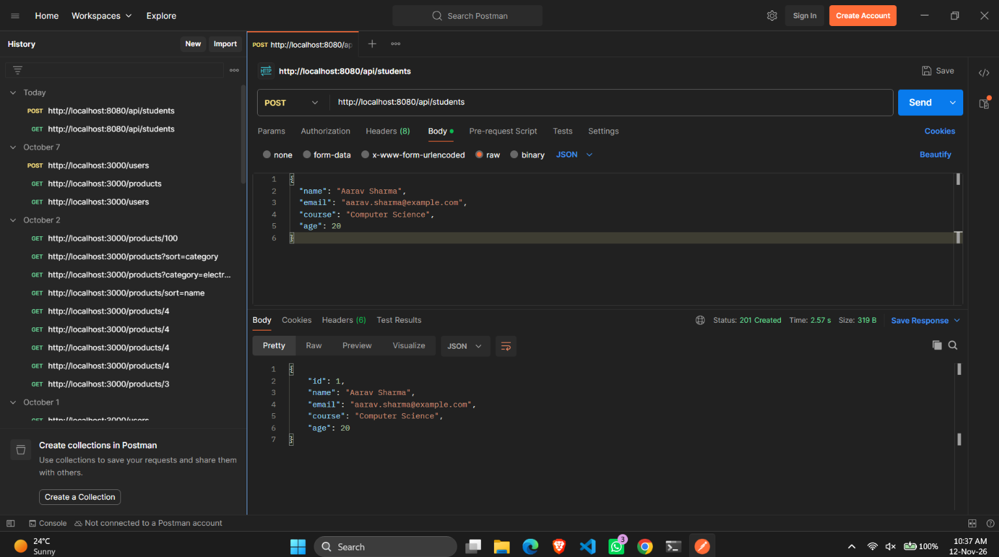
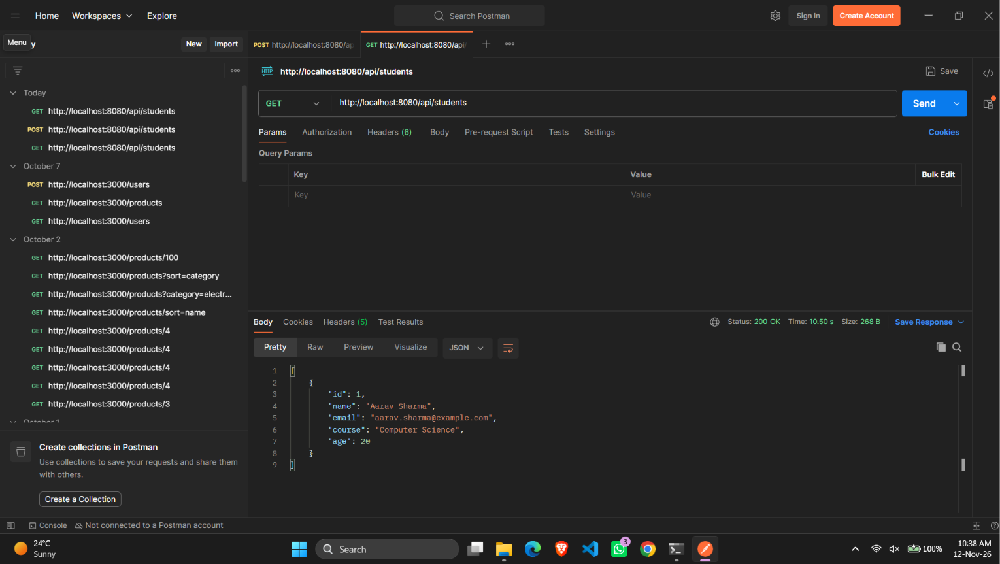
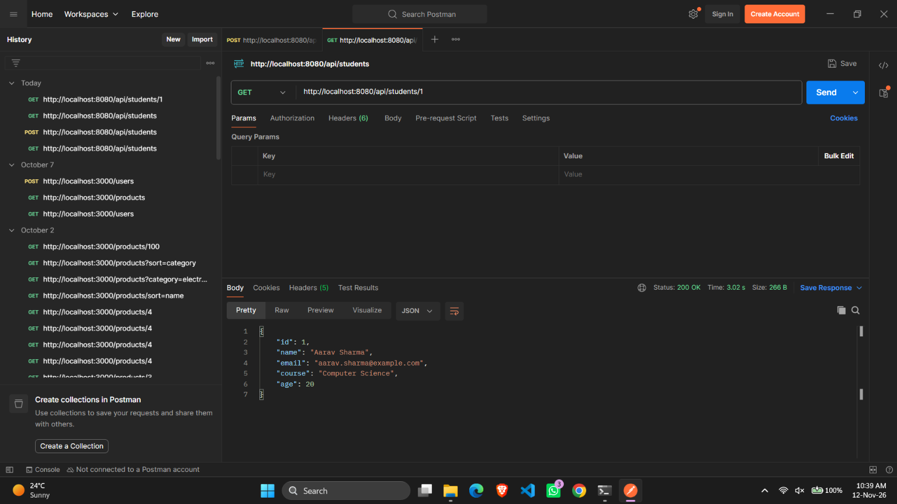
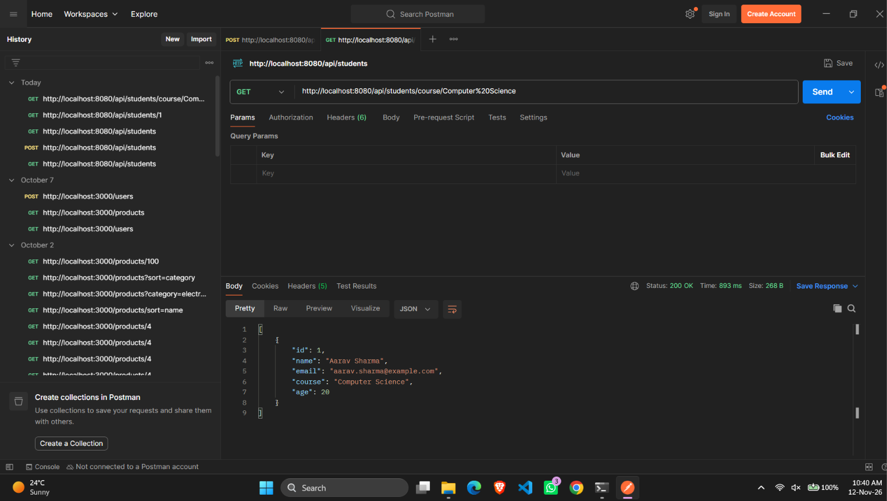
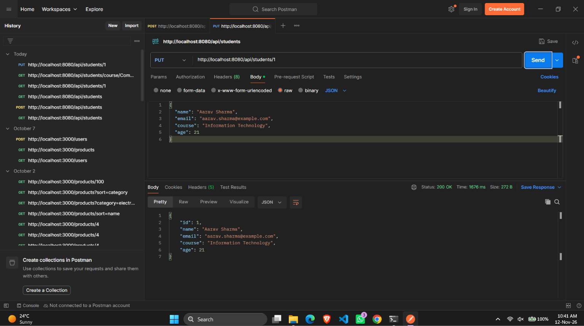
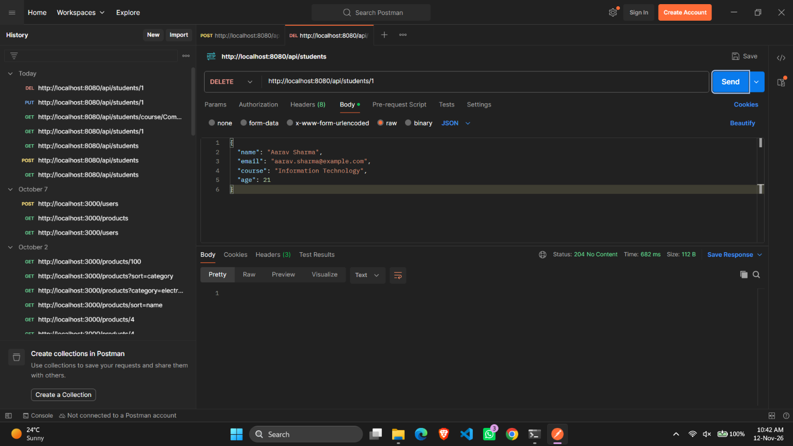
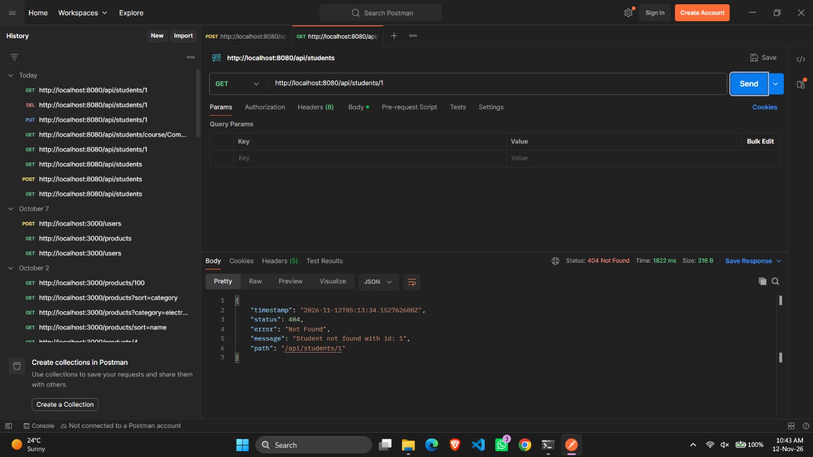
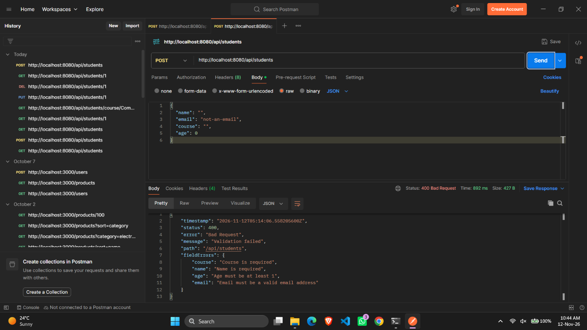

# Swaroop | 24BCS12717 | Student Management REST API Assignment

A Spring Boot REST API for managing student records with Spring Data JPA and MySQL. It supports creating, viewing, updating, deleting, and filtering students by course, with request validation and proper exception handling.

**Repository:** https://github.com/swaroopstack/24BCS12717_Swaroop_PBLJ_Asssignment

## Tech Stack

- Java 17
- Spring Boot 3.3.5
- Spring Data JPA / Hibernate
- MySQL 8
- Maven

## How to Run

### Prerequisites

- JDK 17
- MySQL 8 running on `localhost:3306`

### Database Configuration

The database settings are in `src/main/resources/application.properties`:

```properties
spring.datasource.url=jdbc:mysql://localhost:3306/student_management?createDatabaseIfNotExist=true&useSSL=false&allowPublicKeyRetrieval=true&serverTimezone=UTC
spring.datasource.username=root
spring.datasource.password=${DB_PASSWORD:root}
```

Set your MySQL password if it is not `root`:

```powershell
$env:DB_PASSWORD="your_mysql_password"
```

The `student_management` database and `students` table are created automatically.

### Start the Application

Windows:

```powershell
cd student-management-system
.\mvnw.cmd spring-boot:run
```

macOS / Linux:

```bash
cd student-management-system
chmod +x mvnw
./mvnw spring-boot:run
```

The API runs at: `http://localhost:8080`

## API Endpoints

| Method | Endpoint | Description | Status |
|---|---|---|---|
| `POST` | `/api/students` | Add a new student | `201 Created` |
| `GET` | `/api/students` | Retrieve all students | `200 OK` |
| `GET` | `/api/students/{id}` | Retrieve a student by ID | `200 OK` |
| `PUT` | `/api/students/{id}` | Update student details | `200 OK` |
| `DELETE` | `/api/students/{id}` | Delete a student | `204 No Content` |
| `GET` | `/api/students/course/{course}` | Retrieve students by course | `200 OK` |

## Postman Screenshots

### 1. Add Student — `POST /api/students`

Expected response: `201 Created`



### 2. Get All Students — `GET /api/students`

Expected response: `200 OK`



### 3. Get Student by ID — `GET /api/students/{id}`

Expected response: `200 OK`



### 4. Get Students by Course — `GET /api/students/course/{course}`

Expected response: `200 OK`



### 5. Update Student — `PUT /api/students/{id}`

Expected response: `200 OK`



### 6. Delete Student — `DELETE /api/students/{id}`

Expected response: `204 No Content`



### 7. Student Not Found — `GET /api/students/{id}`

Expected response: `404 Not Found`



### 8. Validation Error — `POST /api/students`

Expected response: `400 Bad Request`



## Assignment Deliverables

- Complete Spring Boot source code — this repository
- Database configuration — `src/main/resources/application.properties` and `database/schema.sql`
- Postman screenshots — shown above
- GitHub repository — https://github.com/swaroopstack/24BCS12717_Swaroop_PBLJ_Asssignment
